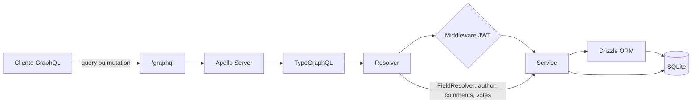

# GraphQL API

API de estudos construída com **TypeScript, Fastify, Apollo Server,
TypeGraphQL, Drizzle ORM e SQLite**. O projeto demonstra autenticação,
usuários, ideias, comentários e votos usando GraphQL.

## Tecnologias

- **Fastify**: servidor HTTP.
- **Apollo Server**: execução das operações GraphQL.
- **TypeGraphQL**: criação do schema a partir de decorators TypeScript.
- **Drizzle ORM + SQLite**: persistência e migrations.
- **JWT + bcrypt**: autenticação e proteção de senhas.

## Como executar

### Pré-requisitos

- Node.js instalado.
- Uma variável `JWT_SECRET` definida no ambiente.

```bash
npm install
```

Crie um arquivo `.env`:

```env
JWT_SECRET=uma-chave-secreta-de-desenvolvimento
PORT=4000
```

Aplique as migrations e inicie o servidor:

```bash
npm run db:migrate
npm run dev
```

A API ficará disponível em `http://localhost:4000/graphql`. A rota
`http://localhost:4000/health` pode ser usada para verificar se o servidor está
respondendo.

## Como o projeto funciona

O cliente envia uma `query` ou `mutation` para `/graphql`. O schema define
quais operações e campos são permitidos. O resolver recebe a operação, o
service aplica a regra de negócio e o Drizzle consulta ou altera o SQLite.



O schema é gerado a partir dos modelos, inputs e resolvers TypeGraphQL e salvo
em [`schema.gql`](./schema.gql). Esse arquivo é uma visão do contrato público;
as alterações devem ser feitas no TypeScript, não diretamente nele.

## Operações principais

### Autenticação

`register` cria um usuário, aplica hash na senha e retorna um access token e um
refresh token. `login` valida e-mail e senha e retorna os mesmos tokens.

Para operações protegidas, envie:

```http
Authorization: Bearer <token>
```

### Ideias, comentários e votos

- `listIdeas` lista ideias.
- `createIdea`, `updateIdea` e `deleteIdea` gerenciam ideias.
- `createComment` adiciona um comentário a uma ideia.
- `toggleVote` adiciona ou remove o voto do usuário na ideia.
- `voteCount` calcula a quantidade de votos com `COUNT(*)`.

As relações são expostas por campos GraphQL, como `author`, `comments` e
`votes`. O cliente escolhe quais campos deseja receber:

```graphql
query {
  listIdeas {
    id
    title
    voteCount
    author {
      id
      name
    }
    comments {
      content
      author {
        name
      }
    }
  }
}
```

Uma única requisição GraphQL pode retornar dados aninhados, mas isso não
significa que haverá uma única consulta ao banco. Field resolvers podem gerar
várias consultas em listas grandes; joins ou DataLoader são alternativas para
reduzir o problema N+1.

## Estrutura resumida

```text
src/
├── database/     # conexão, tabelas, relações e migrations usadas pelo Drizzle
├── dtos/         # formatos de entrada e saída
├── graphql/      # contexto e decorators GraphQL
├── middlewares/  # autenticação
├── models/       # tipos GraphQL de saída
├── resolvers/    # queries, mutations e field resolvers
├── services/     # regras de negócio
└── shared/       # erros, hash e JWT
```

## Estado atual

O projeto está em desenvolvimento. Antes de usá-lo em produção, ainda é
necessário separar o modelo público de usuário para não expor `password`,
implementar refresh token, validar autorização por proprietário em edição e
exclusão, além de adicionar testes e validações mais completas.
